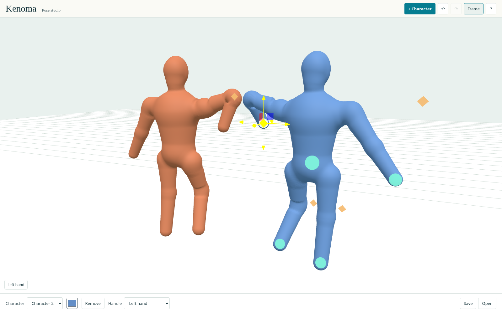

# Kenoma

Anatomically detailed soft- and rigid-body simulation in development, focused on muscles, skeletons and contracting soft tissue. Kenoma aims to make anatomy respond to pose and applied forces, supporting controllable 3D reference for creative tools.

Current work includes an anatomical right-arm research assembly, an illustrated mechanics book and an independent schematic posing editor.


[Anatomical viewer, sources and attribution](docs/review/research-book-teaching/portfolio-anatomy/held-scene.md).

## Explore the simulation research

The [research book and interactive laboratories](education/README.md) connect force, torque, energy, material response, anatomy, contact and spatial solvers. Follow its preview instructions to inspect the teaching and research views.

The current arm is a bounded research assembly. Calibrated tissue behavior and complete whole-body biomechanics remain future work.

## Run the posing editor

The separate poser lets you arrange multiple mannequins with hand/foot IK, bend-plane handles, head orientation, colors and undo/redo.



Requires Rust with the WASM target, Python 3.11+ and the wasm-bindgen CLI version pinned in Cargo.lock, currently 0.2.129. From the repository root:

```sh
rustup target add wasm32-unknown-unknown
cargo install wasm-bindgen-cli --version 0.2.129 --locked
browser/simple-graph/build.sh
python3 -m http.server 8000 --directory browser
```

Open [localhost:8000/simple-graph/](http://localhost:8000/simple-graph/). Drag handles to pose, drag empty space to orbit, right-drag to pan and scroll to zoom. **Save** downloads a scene; **Open** restores it. Save before reloading.

The poser is an artistic rig with no anatomical or collision simulation. See the [editor and embedding guide](browser/simple-graph/README.md).

## Reusable components

[Graph editing](crates/human_core/README.md) · [Connected surfaces](crates/human_surface/README.md) · [Pose deformation](crates/human_rig/README.md) · [SQLite scenes](crates/human_persistence/README.md) · [Architecture](docs/adr/001-simple-graph-boundary.md) · [Background](docs/project-background.md)

The software workspace declares Apache-2.0. Anatomy and third-party material retain their [component licenses](education/data/elbow-v1/LICENSES_AND_ATTRIBUTION.txt).

