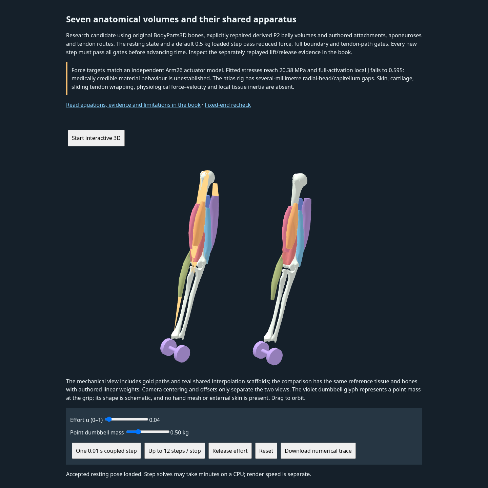

# Anatomical right-arm portfolio capture

**Caption:** Kenoma's existing right-arm research viewer at its stored, held resting state. Three BodyParts3D bones and seven derived muscle volumes appear with authored tendon routes on the left, beside an authored bone-weighting comparison on the right. This is an arm assembly, not a whole-body anatomical poser or a demonstration of medical dynamics.

The unedited 1440 × 1440 Chromium screenshot comes from the preserved `/anatomical-arm/index.html` viewer in the preview built from `b6ff7af9010e867e6f8361ef4c5652147efa8391`. A small native camera orbit exposes the bones and muscle volumes. The original UI, limitations and controls remain visible. No rendering overlay, CSS change, geometry edit or image postprocessing was used.

The left view evaluates the saved reduced resting coordinates; the right applies the existing linear bone-weight comparison at the same joint angle. Gold paths are authored tendon routes, and teal triangles are interpolation scaffolds rather than resolved tissue sheets. The violet dumbbell is a schematic point-mass glyph. The viewer contains no torso, skin or hand mesh.

During capture the browser initialized its residual and finite geometry checks. It did **not** execute a new nonlinear time step or a motion trajectory. Camera input left the complete scientific state unchanged. The displayed effort of 0.04 is an input for a future step; current activation remains zero.

| Initialized observation | Value |
| --- | --- |
| Time / step / newly recorded steps | 0 s / 0 / 0 |
| Held elbow angle | 16.2783° |
| Activation / angular velocity | 0 / 0 rad/s |
| Point mass | 0.50 kg |
| Browser reduced residual | 0.00007035136 N |
| Audited transverse surface crossings / tendon-path violations | 0 / 0 |
| Saved external motor support at held angle | 0.804711 N m |
| New-step work defect | Not evaluated |

These finite, reduced checks do not establish unsupported dynamic equilibrium, material calibration, full nodal convergence, sliding tendon wrapping, finite-radius contact, continuous-motion safety or clinical validity. The existing material and atlas-apposition limitations remain visible in the screenshot. Historical trajectories and rejected solves remain separate evidence.

[Capture provenance](capture-provenance.json) records the exact served executables and data hashes, all 23 verified rest-recheck source hashes, browser settings, camera input, state hashes and initialized diagnostics. The executable hashes match both the teaching-preview manifest and preserved publication manifest. The three documentation files here do not modify that evidence or its qualification.

This image complements the [existing two-character poser screenshot in PR15](https://github.com/MrScripty/Kenoma/blob/9739080116b658e6248816f4e4239c4fde95ca94/docs/images/kenoma-two-character-scene.png). That separate image was inspected at its original 1600 × 1000 dimensions: two colored schematic mannequins with an IK gizmo in the independent artistic scene editor. Its [source contract](../../../../browser/simple-graph/README.md) has no anatomy, muscle-force or collision simulation. PR15 and its assets remain unchanged.

Attribution follows the existing [component license and attribution record](../../../../education/data/elbow-v1/LICENSES_AND_ATTRIBUTION.txt):

- **BodyParts3D, © The Database Center for Life Science licensed under CC Attribution 4.0 International.** [License](https://creativecommons.org/licenses/by/4.0/); [official grant](https://dbarchive.biosciencedbc.jp/en/bodyparts3d/lic.html). The selected 4.0 atlas surfaces use metres instead of source millimetres and explanatory colors. Muscle volumes additionally undergo the repository's authored segmentation, remeshing and explicit reference repairs; attachments and tendon routes are authored. Original historical OBJ notices remain preserved. Mitsuhashi et al., *Nucleic Acids Research* 37 (2009), D782–D785, [doi:10.1093/nar/gkn613](https://doi.org/10.1093/nar/gkn613).
- **Arm26:** The OpenSim Development Team (Reinbolt, J; Seth, A; Habib, A; Hamner, S), adapted from a model originally created by Kate Holzbaur (11/22/04), [CC BY 3.0](https://creativecommons.org/licenses/by/3.0/). Selected model parameters supply independent targets and rigid-body properties; the original XML remains unchanged. Holzbaur, Murray and Delp, *Annals of Biomedical Engineering* 33 (2005), 829–840, [doi:10.1007/s10439-005-3320-7](https://doi.org/10.1007/s10439-005-3320-7).
- Original data processing scripts: © 2026 Kenoma educational data contribution, MIT; Three.js rendering: © 2010–2025 three.js authors, MIT. Existing software notices are retained. OpenArm recordings are not used or displayed in this capture; their separate credits remain in the linked component record. No package-wide license is substituted for these component terms.
