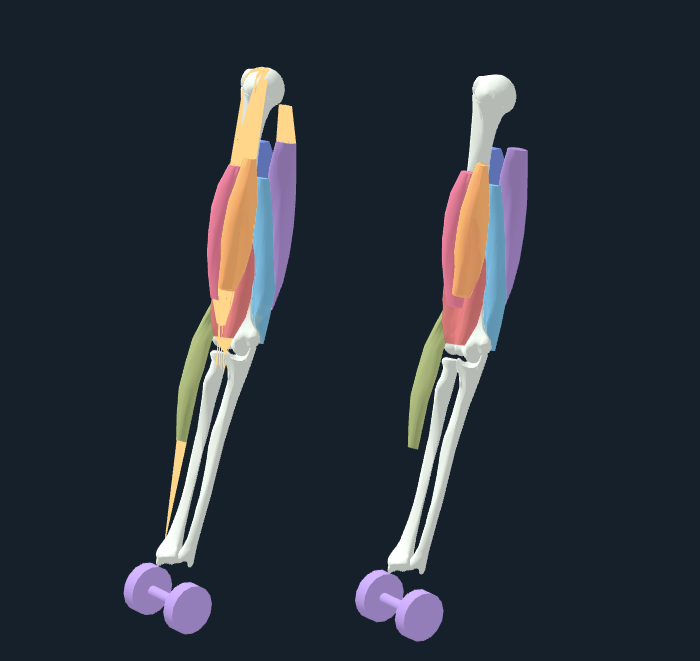

# Held anatomical arm scene

This is the exact scene image approved for public portfolio use. The PNG is unchanged from the reviewed capture.

**Caption:** Kenoma's existing held right-arm reference: three atlas bones, seven derived muscle volumes and authored gold tendon routes, beside the same anatomy with authored linear bone weights. Both views belong to one native 3D canvas. The left view uses saved reduced resting coordinates; the right is a same-angle geometry comparison. This is a right-arm research assembly, not whole-body anatomy or a demonstration of medical motion.

This 700 × 661 PNG captures the complete actual WebGL canvas at a native oblique camera angle. Browser width determines the existing scene's framing and model separation. The existing renderer fixes its pixel ratio at 1; the WebGL drawing buffer is native 700 × 660. The browser screenshot includes one extra boundary row because the canvas lies at a fractional page Y coordinate; no scaling was applied. A higher browser device scale would not add geometric detail, so no scaled substitute is retained. No scene objects were removed; no pixels, anatomy, styles or warnings were edited. The unchanged [full-page evidence](README.md) retains the surrounding UI and limitations. [Provenance](held-scene-provenance.json) records exact image, renderer, source and data hashes, browser/camera inputs and matching state/receipt hashes before and after capture.

The viewer loaded its stored reference and initialized reduced-residual, finite surface and tendon-path checks. Time and step stayed at zero; activation and angular velocity stayed at zero; no new nonlinear step or motion trajectory ran. The 16.2783° joint angle is held with saved external motor support of 0.804711 N m. A 0.50 kg schematic dumbbell is shown. The initialized reduced residual is 0.00007035136 N, with zero audited transverse crossings or tendon-path violations; no new-step work defect was evaluated.

Gold routes and teal shared interpolation scaffolds are authored approximations, not measured tendon anatomy or resolved tissue sheets. The model has no torso, skin, hand mesh, cartilage, sliding tendon wrapping, physiological force–velocity or local tissue inertia. Independent Arm26 force targets do not establish material calibration: existing fits reach 20.38 MPa and full-activation local J of 0.595, with several-millimetre atlas joint gaps. Finite reduced checks do not establish full nodal convergence, finite-radius or continuous contact, patient calibration or clinical validity.

BodyParts3D, © The Database Center for Life Science licensed under CC Attribution 4.0 International. Selected atlas geometry is converted to metres, colored, and explicitly segmented/remeshed/repaired for the derived muscle volumes; attachments and routes are authored. Arm26 credits: The OpenSim Development Team (Reinbolt, J; Seth, A; Habib, A; Hamner, S), adapted from Kate Holzbaur's model (11/22/04), CC BY 3.0. Three.js: © 2010–2025 three.js authors, MIT. Original data processing: © 2026 Kenoma educational data contribution, MIT. Full component notices, citations and modification descriptions remain in [the existing attribution record](../../../../education/data/elbow-v1/LICENSES_AND_ATTRIBUTION.txt) and adjacent provenance. No licenses changed.

Image SHA-256: `f5447eaa7a86935156a347d2fee3bc9f6bfdf03844749fb98fb72b94466caa20`; 68,419 bytes.
